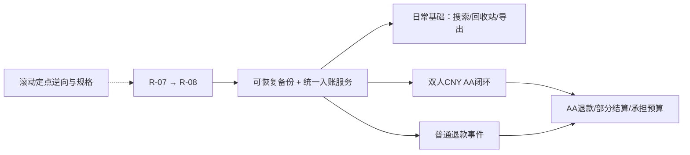

# 钱迹逆向、基础功能迁移与 AA 完善开发计划

调研日期：2026-10-24（Asia/Shanghai）。目标项目：`D:\Projects\AAExpenseSplitter`。参考 APK：`D:\Projects\REA-reverse\qianji_454_1234_gw.apk`。

本文是调研形成并于2026-10-24开始执行的开发方案，不是功能完成清单。任务仍以 [总 TODO](TODO-无障碍自动记账.md) 为唯一状态来源；原65项编号保留，已登记D-01、AA-01～04五个近期待办，复用并前移P2-02、P1-05。早期 [AA 功能框架](AA记账-功能设计框架.md) 仅作愿景参考，当前行为以源码与现行专项规则为准。

执行顺序：**R-07 → R-08 → D-01 → P2-02 → P1-05 → AA-01～04**。本轮从R-07开始，代码、审查、测试和设备证据见 [开发进度](开发进度.md) 与 [测试说明](测试说明.md)；没有通过全部门槛的任务不勾选。搜索/退款等仍按需独立登记，滚动逆向不阻塞当前已明确规格的日历任务。

## 1. 结论与产品范围

建议保留现有 Flutter / Riverpod / Drift 底座，按“钱迹行为调查 → 规则规格 → Dart 实现 → 同场景验收”逐项补齐。首个目标是**可信的个人记账与双人 CNY AA 闭环**，随后增加预算、报销等日常能力。

迁移的单位是业务规则、交互过程、数据关系和验收场景。钱迹是原生 Android 路线，本项目是 Flutter；直接搬入反编译 Java、greenDAO 表或其浮点金额模型，会增加适配成本并破坏已有约束。原始 APK、反编译输出和工具只留在 `REA-reverse`；产品仓库保存规格、独立 Dart 实现与合成测试。

本次“迁移基础功能”与“导入钱迹历史账单”是两项工作。前者是主线；后者需要真实导出格式样本，列为可选的数据迁移工作包，不作为 AA 开发的前置条件。

### 2026-10-24 初始调查（后续开发证据另见进度）

- 核对当前分支 `Glm5.3F`、HEAD `9c4a4e9`，版本 `0.2.0+5000`、数据库 schema 6；原有未跟踪目录 `TestPictures/data/` 保留。
- 审阅当前产品源码、现行计划、测试与交接文档；区分历史设想、菜单占位和实际代码。
- 阅读钱迹官方指南及 Android 更新记录，发现部分页面与版本更新存在差异。
- 在 `REA-reverse/tools` 局部安装固定版 **REA 6.7.0**，禁用 npm 安装脚本；未全局安装、未注册 MCP、未修改助手配置。
- 下载 **jadx-headless-mcp 0.7.1** 并核对固定 SHA-256；实际使用 REA 成功执行 **1 次包清单、5 个类清单、11 个方法反编译**，共 17 次调用。
- 初始调查运行现有 `aa_sync_service_test.dart`、`balance_test.dart`、`report_test.dart`：**79/79 通过，runner 约 15 秒**。测试伴有 Drift 多实例警告，未将其记为警告清零；该调查阶段未做全量或设备验收。随后R-07实施的全量/构建/设备记录见开发进度，不沿用调查结果代替功能验收。

本轮未启动钱迹、登录账号、访问其私有接口或读取真实账本。静态代码证据不能替代交互和数据库运行验证。

## 2. 两个 App 的当前基线

### 2.1 钱迹 APK

| 项目 | 实际证据 |
|---|---|
| 文件 | `qianji_454_1234_gw.apk`，43,023,520 bytes |
| SHA-256 | `f7afc6220029fbe7d6f85b60105fb890caac8a880721a3c7ffc3dd7447a167b8` |
| 包名 / 版本 | `com.mutangtech.qianji` / `4.5.4`，versionCode `1234` |
| Android | minSdk 26、targetSdk 35；与官方 2026-10-13 正式版记录对应 |
| 结构 | 5 个 DEX，业务模型与部分方法名可读；有 greenDAO、MMKV、OCR 等线索，未见典型 Flutter/RN 载荷 |
| REA/JADX | 引擎报告 15,361 个类、4,619 个资源；该数字与 DEX 原始定义扫描的统计范围不同 |
| 关键模型 | `Bill`、`BillExtra`、`AssetAccount`、`Category`、`Book`、`BookMember`、`Budget` 及 DAO |

业务结构可读，足以支持定点调查。未对整个 APK 作完整反编译，也没有验证 APK 签名或每条动态调用路径。

### 2.2 自有项目的能力差异

| 能力 | 项目现状 | 计划处理 |
|---|---|---|
| 手动收支、计算键盘、备注、时间、编辑删除 | 已有 | 保留并抽取统一入账服务，不重写页面 |
| 两级分类、迁移、删除转移 | 已有 | 继续保留历史引用保护；补 AA 完整路径兼容 |
| 六币种、账户实际额、跨币转账与手续费 | 已有 | 作为迁移必须保持的基线 |
| 月/年/范围报表、分类明细、原币/CNY总览 | 已有 | 复用同一选集与逐笔折算值，继续保证金额守恒 |
| 日历 | R-07、R-08 未完成 | 保留原编号和先后顺序，作为第一批可见交付 |
| 搜索与账户/分类/金额等组合筛选 | 未交付 | 作为高频基础能力补齐 |
| 普通导出、完整备份恢复、回收站 | 菜单占位或缺界面 | 先做可恢复备份，再做导出与可追溯恢复 |
| 不计收支/预算的独立账单开关 | 当前没有完整模型 | 与分类类型分离，迁移时保持旧报表结果 |
| 退款、报销、预算 | 未交付 | 先普通退款；报销和预算在口径稳定后接入 |
| 标签、多账本、周期/分期、债务管理 | 未交付 | 按需求后置，不作为双人 AA 前置 |
| 双人 AA | 已有 CNY 平分、状态、差额、文件同步、逐条结算 | 先修正规格和协议，再增强份额与结算 |
| OCR | 本地图片辅助回填已实现 | 保留，后续接统一入账服务 |
| 无障碍/后台自动记账 | 尚未实现 | 保留原 P2～P7 任务，放在基础与 AA 稳定之后 |

当前底座包含 Accounts、Categories、Bills、AaGroups、Settlements、MetaEntries 六表。没有现成的多账本、成员份额、退款关系、报销、预算、导入批次或同步操作日志实体。

源码依据见 `app/lib/data/app_database.dart`、`app/lib/utils/balance.dart`、`app/lib/utils/report_filter.dart`、`app/lib/sync/aa_sync_service.dart`。完整逐行盘点见 `D:\Projects\REA-reverse\analysis\project-audit.md`。

## 3. 逆向调查怎么服务开发

### 3.1 每项能力交付一份小规格

每份规格包含：目标版本与摘要、用户操作、输入字段、实体关系、金额/日期/状态规则、修改与删除效果、列表/余额/报表结果、证据位置、未证实部分、对应合成用例。

证据分五类标记：`DOC` 官方说明；`STATIC` APK 静态观察；`RUNTIME` 指定版本实际观察；`PROJECT` 自有项目源码/测试；`PROPOSED` 新产品设计。字段存在不代表功能行为已证明；反编译成功不代表算法与动态分支已验证。

### 3.2 按问题选方法，不全包追代码

| 调查包 | 钱迹定位点 | 需要回答的问题 | 当前证据与下一步 |
|---|---|---|---|
| 基础账单与统计 | `Bill`、`BillExtra`、DAO、添加账单保存链 | 金额、账户实际额、统计额、旗标怎样分工？ | 字段及选定方法已取证；下一步追一次保存/编辑/删除事务及刷新链 |
| 账户与转账 | `AssetAccount`、`Bill.setTransferAsset`、`TransferPresenterImpl` | 本金、费用、两侧账户金额如何保存？ | 已见转出/入账户及 `extra.transfee`；需对照实际录入与余额变化 |
| 退款 | `RefundPresenterImpl`、`refundSourceBillId`、相关总额方法 | 多次部分退款、原单关联、超额、跨期、删除怎样处理？ | 已见 submit 组装原单及退款字段并调用远端 refund API；后端限制、跨期及本地保存仍待验证 |
| 报销 | `BxPresenterImpl`、`baoxiaoSourceBillId`、`baoxiaoExtras` | 垫付、报销到账、差额是否分开？ | 已取 doBaoXiao，存在排序/分配及远端 baoxiao 提交；文本有类型推断、重复块及 ?? 变量警告，仅作结构线索 |
| 分类/日历/搜索/预算 | `Category`、`Budget`、相关查询与页面 | 分类树、范围边界、组合筛选和预算选集怎样定义？ | 分类模型已见；优先补实际影响本项目的查询与边界，不照搬 UI |
| 导出适配（可选） | 公开 CSV/JSON 导出与原单标识 | 是否保留稳定 ID、币种、关联、账户和期初额？ | 尚无该 APK 导出样本，不承诺无损迁移 |

已实际取得的 `Bill` 方法包括 `getMoneyForStat`、`getRealMoney`、`getTotalRefundMoneyStat`、`setTransferAsset`、`isNotCount`、`isNotBudget`。后两者分别读取 flag 1、flag 2；`getMoneyForStat` 按目标币种读取扩展金额，缺少时回退主金额。另由 REA 核实辅助函数 `za.j.j` 用 BigDecimal.subtract 逐项相减，确认 `getRealMoney` 依次扣退款、再扣 V2 已报销金额；尚未证明所有报表、预算和账户余额都调用它。

退款和报销入口会提交远端 API，这一事实说明 APK 不包含完整后端规则。报销方法虽返回 complete 源文本，却存在明确反编译缺陷；完整文本不等于正确算法。后续以调用者、回调、本地保存与合成行为核对补证，不直接移植这段方法。

### 3.3 动态验证的范围

后续在隔离测试设备/新实例使用合成账本，不覆盖两台已有雷电的真实数据。先做无需登录的离线功能；需要账号、会员或服务端才能观察的规则单独标注依赖，不将其静态补猜为已验证。

每个场景同时记录操作前后：账单明细、相关账户余额、分类/期间统计、关联单据。页面截图和数据库若可合规取得，只保留合成数据。无需为了迁移基础功能研究会员校验、云端鉴权或私有服务协议。

## 4. 哪些规则适合借鉴，哪些必须按本项目重建

| 钱迹线索/行为 | 本项目的落地方式 |
|---|---|
| Bill/BillExtra 把主记录与退款、报销、币种、旗标分开 | 用明确类型和关系表达业务扩展；继续保留本项目交易原币/账户实际额的区分 |
| `money` 在 DEX 中为 double | 不采用其金额表示；继续 int64 最小单位持久化、BigInt 聚合与明确舍入 |
| `FLAG_NOT_COUNT` 与 `FLAG_NOT_BUDGET` 独立 | 新建独立统计/预算策略；旗标不阻止账户真实动账、不消除 AA 债务 |
| 退款/报销带原单关联 | 关联原消费与到账事件；可撤销、可审计，不作为无来源普通收入 |
| Book 与 BookMember | 可借鉴账本作用域；成员/录入者不等于付款人/受益人，不直接作为 AA 模型 |
| 钱迹各账本共用个人资产 | 若以后做多账本，应先固定账户作用域，防止切账本重复或漏算余额 |
| 官方转账例子：录入1001、手续费1、到账1000 | 本项目目前本金1000+手续费1=总扣1001；保留既有规则，在交互中写清本金/费用/总扣款，导入时做显式转换 |
| 导入不自动调整历史资产余额 | 本项目若导入历史必须有余额模式与预览；不能把导入后余额错误当兼容行为 |
| 官方导出声明不等于可回导备份 | 区分 CSV 交换文件与完整版本化备份，后者须实际恢复验证 |

官方来源：[共享账本](https://docs.qianjiapp.com/vip/vip_book_share.html)、[手续费与优惠](https://docs.qianjiapp.com/ji-zhang-jie-mian/fee_or_coupon.html)、[不计入设置](https://docs.qianjiapp.com/ji-zhang-jie-mian/not_include.html)、[报销](https://docs.qianjiapp.com/ji-zhang-jie-mian/baoxiao.html)、[数据导入](https://docs.qianjiapp.com/other/import_guide2.html)、[Android 导出](https://docs.qianjiapp.com/export_guide.html)。

## 5. AA 要先冻结的账务规则

### 5.1 当前实现必须先如实保留

- 双人、固定平分、CNY；奇数分由垫付人多承担 1 分。
- 垫付方保留真实账户的全额支出；接收方确认仅更新状态，不建立份额明细。
- 待确认和已确认的未结算组都参与当前差额；退回/取消不参与。
- 结算时按组生成收入或支出，使用所选真实 CNY 账户，账单日期为原消费日期。
- 净额为零时当前 `settle` 返回，不关闭非空抵销周期。
- 文件全量交换、时间戳合并、重复导入保护与已结算保护已经存在。

上述是兼容基线，不等于新版推荐规则。AA 服务顶部和部分测试标题仍有旧“确认生成挂账”描述；先统一文字与状态机，不能依据旧注释重建挂账流水。

### 5.2 新版至少分清三套数

| 口径 | 回答的问题 | 例：A付100、B付60、两人平分 |
|---|---|---|
| 真实资金流 | 我的真实账户何时实际收付？ | B向A实际转20；A账户合计-80，B合计-80 |
| 个人消费承担 | 这次消费我应承担多少？ | A=80，B=80，总消费160 |
| AA未清往来 | 当前谁仍欠谁多少？ | 结算前A应收20、B应付20；完成后均0 |

当前 A 结算账户会生成收入50与支出30，净额20正确，但这不是实际发生两笔转账，也不是个人消费承担。新版应增加明确的查询投影和结算分配关系，逐步消除该歧义；旧流水保持兼容，不静默删除或重复补记。

建议先增加“现有收支口径/个人承担口径”，把真实资金发生日与原消费发生日分别保留。是否把现有首页切换为严格现金流口径，在新版规格和迁移预览中明确，不直接改默认值。

### 5.3 设计约束与建议默认值

1. 成员至少区分录入者、付款者、承担者、账户所有者。只动本机拥有的真实账户，伙伴账户用支付事实表示。
2. 原始份额为不可变金额快照，`sum(originalShares) = originalExpense`；退款和更正保存独立、带符号的份额调整，`sum(netShares) = netExpense`。当前平分舍入保持原规则；其他比例以后扩展，不能覆盖旧快照。
3. 净应收定义：`净支付 - 净承担 + 已向伙伴结算 - 已收到伙伴结算`。这里“净支付”仅指对商户的实际代付减收到的商户退款，排除伙伴结算与旧 settlementId 衍生收支，避免重复计算。退款同时调整净支付和净承担；所有成员净应收之和为零。
4. 建议将“待确认估计差额”和“已确认可结算差额”分开展示，新版默认只结算已确认组；旧版行为通过协议/记录版本保留。该行为改变须先落成专项规格。
5. 建议支持“净额0的非空已确认周期”关闭，记录 covered IDs 而不制造0元资金流水；无组时无操作。
6. 已结算原账继续只读；退款或记错通过新调整/冲销记录产生新的差额，保留旧结算依据。
7. 退款首期只开放普通单据；在 AA 退款规则和协议未交付前，对 AA/结算关联单明确拒绝，不能只在 UI 隐藏入口。
8. 换绑应有 `pairingId` 与成员身份隔离；旧关系归档，旧文件不能进入新关系。现有全表导出与覆盖 partnerUid 的路径需专项整改。
9. 保持 CNY 双人离线文件模式直到本地账务和新旧协议互导通过。云同步、多币种 AA、多人分摊独立排期。

## 6. 分阶段开发路线

阶段表示工作包，不要求全部串行。阶段0按功能滚动取证，不阻塞已有明确规格的R-07/R-08。阶段1与阶段2完成后，阶段3日常完善和阶段5 AA主线可按收益交替推进；搜索、CSV、回收站、普通退款均不是配对隔离或AA分类路径修复的硬前置。AA退款需要普通退款事件模型和AA份额/结算模型都稳定。

每一小点仍遵循现有“代码复审 → 专项/回归 → 双雷电实际操作 → 提交推送”门槛。新增近期工作包和P2-02前移已同步到总TODO，不另建完成勾选清单；登记不代表交付。

### 阶段 0：固化调查证据与规格

**交付**：版本清单、功能差异矩阵、普通账务与 AA 口径表、关键功能规格和合成账本。

- 退款/报销客户端远端提交已观察，继续追踪响应回调、本地保存事务、余额更新及实际报表调用链。
- 标明静态无法确认的账户余额更新、事务、跨期退款和同步规则。
- 在隔离设备完成普通收支/转账/退款的最小行为对照，再进入相关实现。
- AA 默认值按 §5 写成可执行的示例规格；未决产品选项集中维护，不散落在代码中。

**完成门槛**：每个准备迁移的规则至少有明确证据或标注为自有设计；每个金额例子能手算并变成测试，未知事项有下一步验证方法。

### 阶段 1：完成当前日历收尾

**任务**：沿用 **R-07 → R-08**，分别交付。R-07 做完整日期聚合，R-08 再接月历和每日明细筛选，不重做 R-06。

**完成门槛**：月总额=逐日之和，分类/日历/明细同集合；闰月、跨年、原币/折算与编辑刷新正确；保持现有两页范围与视图独立性。该阶段不需要数据库重构。

### 阶段 2：建立可恢复的数据底座和统一入口

**工作包 A：完整备份与恢复。** 独立于 `.aas`：版本化 manifest、表/行身份、币种、分类树、关联、删除状态、汇率设置和完整性校验；配对密钥的备份策略单独说明。备份须使用一致性快照或协调连接/WAL状态，不能直接复制活跃sqlite文件而遗漏WAL。导入先在临时库校验，成功后协调关闭连接并原子替换/受控导入；失败保留原库。加密格式留存 KDF/盐/nonce/版本，优先复用经审查密码库。

**工作包 B：前移现有 P2-02 统一入账服务。** 把手动/OCR/后续输入的校验、事务与 AA/费用关联从页面抽到服务；分步接入，先不改变现有业务结果，不把未来 P2-01/03/04/05 一并宣布完成。

**工作包 C：数据升级策略。** schema 6 的六表建立合成升级样本，并保留已有 schema1～5 直接升级新版本的历史库回归；新字段用兼容默认值，关联可追溯，失败回滚。每次只引入当阶段必需字段/表，避免一次建齐所有远期实体。

**完成门槛**：合成旧库备份→恢复后账单/余额/AA/结算/分类/汇率一致；错密码、损坏、未知版本、恢复中断不损坏现有库；统一服务与旧保存路径同场景等价。破坏性恢复和中断试验使用临时库、独立测试命名空间或隔离设备；两台既有雷电只做保留用户数据的覆盖升级和常规回归。

### 阶段 3：补齐个人记账的日常闭环

按独立小点依次做：

1. 搜索与组合筛选：备注关键词、日期、类型、账户、完整分类路径、币种、金额区间；同额同日两笔仍是两笔。
2. 回收站与关联恢复：先普通单，明确保留/永久删除政策；费用随转账、已结算保护继续有效，恢复不能重复造关联。
3. 账单级独立统计与预算开关；历史迁移复现现有 `filterReportBills` 结果，尤其不能把所有 kind=2 账单一律排除。
4. CSV 导出与导出预览：固定字段、币种/精度、完整分类路径、关联与特殊类型说明。CSV是交换文件，不宣称可恢复所有状态。

**完成门槛**：筛选结果的集合与合计一致；导出金额可回核；删除/恢复后余额和统计精确回到原值；新开关不更改资金和 AA 权利义务。

### 阶段 4：迁移普通退款能力

先支持“CNY交易＋CNY真实账户”的普通支出部分/全额退款，再扩展外币交易或外币账户实际付款。建议显式退款事件/关联表，不依靠备注解析；记录原单、退款资金发生日、到账账户/实际额和消费冲减归属。交易币种是CNY不代表账户也一定是CNY，第一期必须在服务层核对两者。

必须决定：退款记入原消费期还是退款期的消费报表；建议资金视图用到账日、消费分析沿原消费关联，界面明确口径。每种视图仍需保证明细与合计一致。

**完成门槛**：100元支出退30/再退70、删除某次退款、跨月退款、重复点击、原单删除、修改上限均有测试；AA/已结算单据未经设计的路径在服务与数据库层拒绝。不得把“钱迹某版本上限”作为本产品默认规则而不写规格。

### 阶段 5：补齐双人 CNY AA 可信闭环

1. 先做 **P1-05 完整分类路径兼容**：快照保留父子路径、唯一匹配、歧义落未分类、旧文件兼容，不按首个同名分类猜。
2. 配对/身份隔离与归档：显式 pairingId、稳定双方身份，换绑前预览未清往来；不将全部旧组导出给新伙伴。
3. 显式份额与结算分配：首期仍固定双人平分，但持久化份额/舍入快照和 settlement→group 的金额分配，为部分结算留出明确语义。
4. 先增加个人承担查询投影，再处理 §5.2 的旧结算流水；新记录用版本区分，旧历史给迁移预览，不静默重新入账。
5. 确认/退回/重发/取消、净额0关闭周期和已结算更正的状态机；已结算保护保留数据库事务守卫。
6. 新文件协议：版本、pairingId、成员、实体修订与操作身份、删除墓碑、结算覆盖及错误边界；兼容导入旧 `.aas`。语义无法无损降级时拒绝导出旧格式并说明。

**完成门槛**：A付100/B付60后各承担80、B付A20后债务为0且真实净流出各80；奇数分不丢失；双机互导、离线旧文件、新旧版本、退回重发、同毫秒/时钟偏移和结算交叉均不重复记账、不复活删除项。

### 阶段 6：AA 部分结算、退款与个人预算

按小点扩展：部分结算分配规则 → AA未结算退款 → 已结算后的调整单 → 个人承担口径预算。

- 部分结算需明确按选单或固定顺序分配，余额与分配合计一致。
- AA退款按原份额冲回；已结算后向收到商户退款的人形成新往来，不改旧转账事实。
- 示例：A垫300，两人已各担150且B已付A150；商户退A60后，双方各担120，A应退B30。
- 预算默认取个人净承担；“不计预算”独立于收支与债务。先做单月总预算/分类预算，再决定年度、结转与自定义月起点。

**完成门槛**：退款、部分结算与预算的明细均能回溯原单；不同日期/类别/承担视图守恒；旧CNY AA仍可导入且不会重记。

### 阶段 7：按需扩展与发布

基础与 AA 稳定后分别排期：报销（外部垫付/到账/差额）、钱迹历史数据导入、标签、多账本、周期账单。云同步、多人/比例分摊、外币 AA 与复杂信用分期独立设计，不混入双人 V1 的交付范围。

无障碍继续复用原 P2～P7：统一来源、候选、幂等、节点/OCR与后台队列；账务规则未覆盖的特殊交易先待核对。识屏不作为本阶段 AA 成败的依赖。

发布前处理现有关于版本、清空测试数据入口的 debug 门控、正式签名与备份恢复说明；补真机、权限/生命周期、规模性能和升级验收。当前全量 watch/内存聚合不能据此宣称支持十万账，先压测再定索引/分页。

## 7. 数据与架构的增量落点

- 保留 Drift/SQLite、Riverpod、现有金额/汇率/选集工具，不更换技术栈或一次重写数据库。
- 建议 application/service 层接入“命令输入 → 校验 → 事务 → 关联变化 → 结果”，按手动/OCR/导入逐入口替换；关键防护仍放在事务边界。
- 账单现金变动与消费投影分离；业务种类使用具名语义，避免把退款/结算强塞为所有页面默认统计的普通收入。
- 退款、结算分配、来源导入批次、配对等关系按阶段新增，不把关联只藏在 note 或无约束 JSON 中。
- `Bills.type` 旧0/1/2/3、`feeTransferId`、`aaGroupId`、`settlementId` 的含义和旧记录保持；新模型需要显式版本与迁移映射。
- AA类别快照与本地分类ID分开：共享内容用于展示，本地映射用于统计，缺失/歧义不强建分类。
- 当前`.aas`密码派生使用固定应用盐、配对口令保存在meta；新协议逐步引入按配对随机参数和系统安全存储，并保留旧文件解密路径。密码学改动必须独立审查。

## 8. 共同验收场景

| 场景 | 必须满足的结果 |
|---|---|
| 普通支出100→改120→删→恢复 | 真实余额、分类/日/月合计随同一事件变化，恢复后精确回到删除前 |
| 本金1000+费1转账 | 出账1001、入账1000、消费仅1；跨币按已保存双额，不用当前汇率重算历史 |
| 同日同金额两笔真实消费 | 不自动合并；来源重试同一笔则幂等 |
| 不计收支×不计预算四组合 | 资金变化不变；两套统计独立；AA债务不消失 |
| 普通消费100、分两次退款30+70 | 净消费0、实际到账按每次账户和日期；撤销一次退款回到相应状态 |
| A付100、B付60 | 双方各担80；仅B向A实际结算20；结算后净债务均0 |
| 奇数分101分两人 | 现有规则付款人51/伙伴50；反复查看/导入后不漂移 |
| 双方各付100，未清净额0 | 新版允许显式关闭已确认周期；无虚构资金流水；旧版保持兼容 |
| 待确认/退回/改额/取消 | 估计与可结算金额按规格变化；改额重确认；旧文件不恢复已取消状态 |
| 已结算后退款60 | 通过新调整形成正确返还，不改变旧结算事实或再导入重复入账 |
| 不同一级下同名二级 | 通过完整路径唯一映射，歧义保留为未匹配，金额不变 |
| 换绑后导入旧伙伴文件 | 关系隔离，不能覆盖新身份或混入新差额 |
| schema1～6→新schema/恢复中断 | 旧账余额和全部关联可核；失败回滚，不靠清库修复 |
| 新旧`.aas`、乱序、重复、缺账户 | 正确兼容或明确拒绝；不会部分修改后报错、重复落账或猜币种 |

以后每小点按实际影响选择专项，依照现行交接要求跑全量短回归、分析、debug构建及双设备操作。真机/正式发布验收单列。测试数据使用合成账本，设备操作前后核对业务指纹并精确清理，不清空用户数据。

## 9. 钱迹历史账单导入（可选工作包）

需先取得该版本的匿名合成 CSV/JSON 导出，核对字段与不支持项，不能只按文档承诺无损。

设计流程：文件识别 → 编码/币种/时间校验 → 分类/账户映射 → 关联重建预览 → 余额模式选择 → 事务导入 → 批次报告/可撤销。

余额模式须明确选择“完整流水重建期初”或“保留截止日余额”；每种模式给导入前后余额预览。重建模式必须给定起始日与可核对期初额，流水不完整时标记无法证明完整。保余额模式需通过可审计的期初调整或截止日补偿实现，并说明历史余额曲线会如何变化；补偿与导入批次一起撤销。验收例：当前1000、导入过去支出100后选择保余额，当前仍1000；撤销批次及补偿后恢复原状态。

金额按十进制字符串解析成各币最小单位，禁止经过 double。去重优先源稳定ID+来源命名空间；无可靠ID只提示相似，不按同日同额丢弃。

原单关联缺失、债务/分期等未支持类型进入隔离清单，不伪装普通收支；导入不能自动标 AA 或生成伙伴身份。批次撤销发现已被用户编辑/被新单引用时需冲突处理，不按来源批量硬删。

## 10. 推荐的下一次开发范围

下一次只做 **R-07 月日历聚合**，复用当前报表选集和逐笔值，暂不改数据库、AA协议或页面交互；验收后再独立做 R-08。

与此同时，逆向研究继续独立产出退款/报销规格。完成日历收尾后，进入阶段2的“完整备份与恢复 → P2-02统一入账服务”，优先衔接P1-05、配对隔离和AA结算投影；搜索、回收站、导出与普通退款按需独立插入，不阻塞AA主线。这样每次都有可见成果，也能在改变复杂账务前提供恢复能力。

## 调研材料与来源

- `D:\Projects\REA-reverse\analysis\project-audit.md`：自有项目源码与缺口盘点。
- `D:\Projects\REA-reverse\analysis\qianji-docs-audit.md`：官方业务规则、页面链接和版本冲突。
- `D:\Projects\REA-reverse\analysis\apk-audit.md`：APK/DEX/REA方法证据与限制。
- `D:\Projects\REA-reverse\analysis\apk\`：版本、摘要、清单、类/方法以及REA Evidence JSON。
- `D:\Projects\REA-reverse\analysis\apk\commands.md`：固定版本、环境与17次成功REA调用的复现清单。
- 钱迹：[用户指南](https://docs.qianjiapp.com/)、[Android更新记录](https://docs.qianjiapp.com/change-log/change_log_android.html)。
- REA：[Android分析](https://github.com/morluto/rea/blob/main/docs/android-analysis.md)、[MCP结果协议](https://github.com/morluto/rea/blob/main/docs/mcp-contracts.md)。

公开仓库 main 与实际发布包可能不同。本轮真实安装的REA6.7.0包 engines允许Node24.18，而调研时main所示版本下限更高；复现以本地package-lock、包内容和Evidence中实际引擎身份为准。
